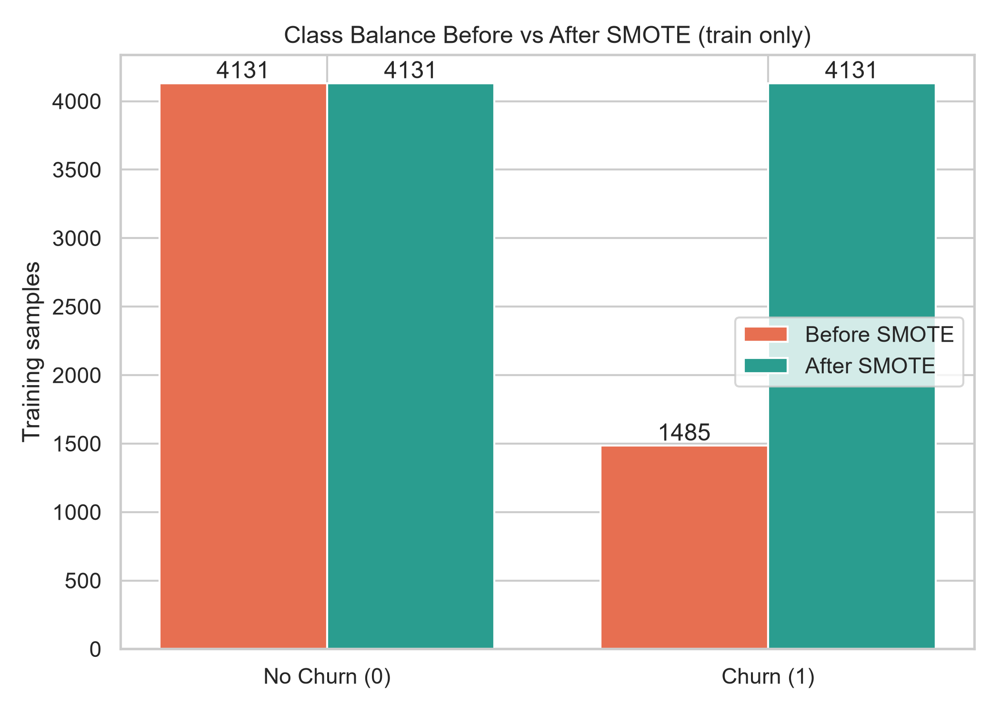
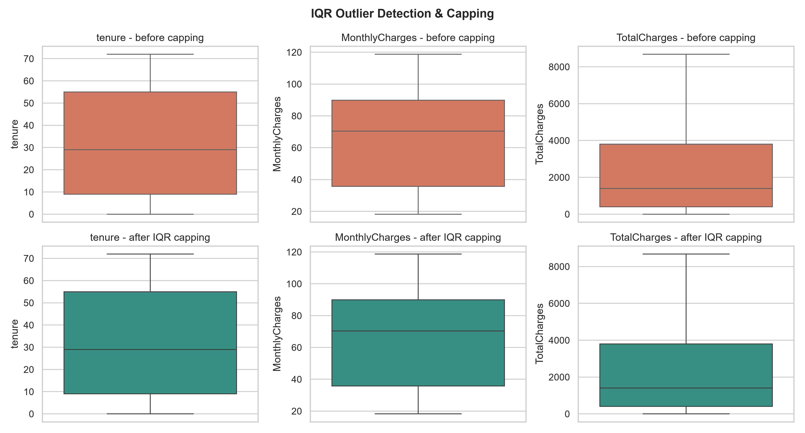
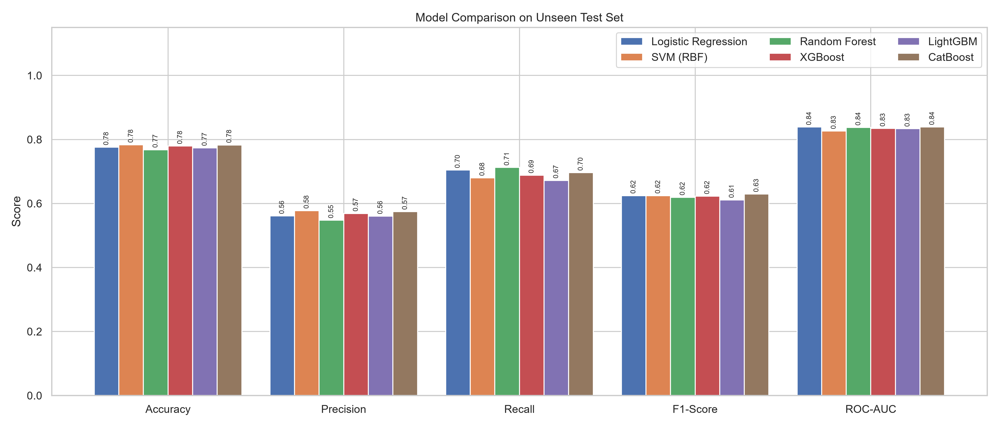
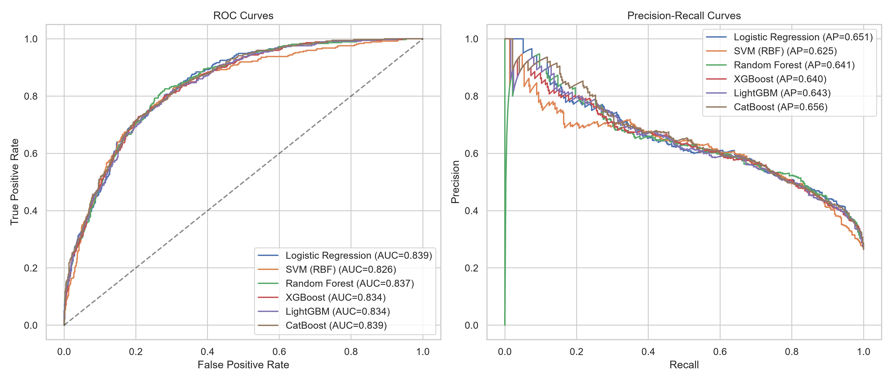
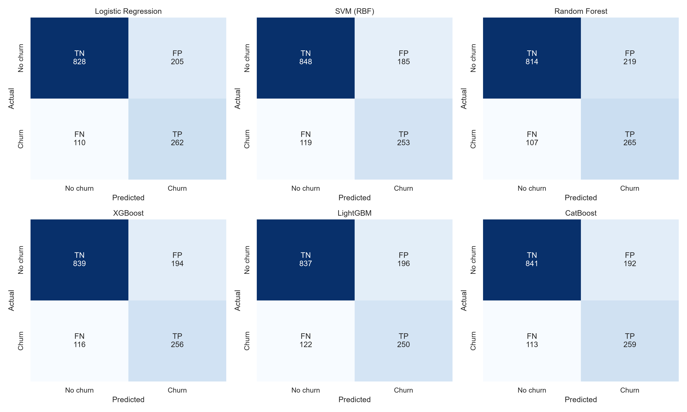
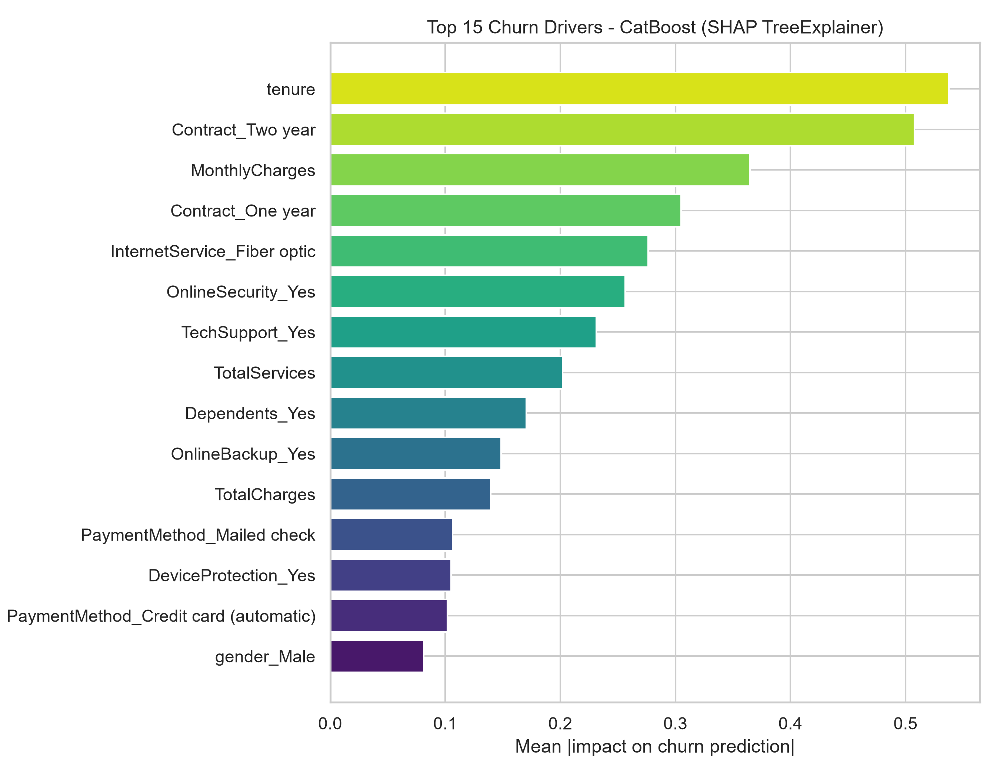

# Telecom Customer Churn & Retention Intelligence System - Report Draft

## 1. Introduction
Customer churn is a major cost driver in telecom: acquiring a new customer typically costs
5-25x more than retaining an existing one. This project builds an end-to-end ML system on the
IBM Telco Customer Churn dataset (7043 rows, 21 columns; source: IBM Telco (downloaded))
that predicts churn and recommends retention actions. Objectives: (i) leakage-free preprocessing,
(ii) comparison of six classifiers, (iii) an accessible Streamlit application.

## 2. Literature Review
Recent work consistently shows that ensemble/boosting models, class-imbalance handling and
interpretability are central to churn prediction.

| Paper | Venue | Models | Key finding |
|---|---|---|---|
| Alotaibi & Haq (2024) | ETASR, DOI 10.48084/etasr.7480 | Ensemble ML methods | Ensembles outperform single classifiers for telecom churn |
| Mahmoud & Abdel-Fattah (2024) | J. Big Data (Springer) | Hybrid framework | Hybrid pipelines improve churn accuracy |
| Imani et al. (2024) | IEEE | RF, gradient boosting + SMOTE/ADASYN | Oversampling materially changes boosting performance |
| Noviandy et al. (2024) | Infolitika J. Data Sci. | Model-agnostic interpretability | Explainability exposes actionable churn drivers |
| Elkhoudary et al. (2025) | IEEE ICEEI, DOI 10.1109/ICEEI68459.2025.11330530 | LightGBM | LightGBM is strong for subscription churn |

## 3. Methodology

- **Logistic Regression:** $P(y=1|x)=\sigma(w^Tx+b)=1/(1+e^{-(w^Tx+b)})$, minimising log-loss with L2 penalty.
- **SVM (RBF):** $K(x,x')=\exp(-\gamma\|x-x'\|^2)$; maximises margin with soft penalty $C$.
- **Random Forest:** average of bagged decorrelated trees, $\hat y=\frac1B\sum_b T_b(x)$.
- **XGBoost:** $\mathcal L=\sum_i l(y_i,\hat y_i)+\sum_k\Omega(f_k)$, $\Omega=\gamma T+\frac12\lambda\|w\|^2+\alpha\|w\|_1$.
- **LightGBM:** leaf-wise (best-first) tree growth choosing the leaf with maximum loss reduction, with histogram binning and GOSS.
- **CatBoost:** ordered boosting with ordered target statistics to reduce prediction shift.

## 4. Data Cleaning and Preprocessing
- `TotalCharges` held 11 whitespace strings (all with tenure = 0); nulls before/after: 11 / 0, imputed with 0.0. Duplicates dropped: 22.
- IQR capping: $[Q_1-1.5\,IQR,\;Q_3+1.5\,IQR]$. Outliers capped: tenure=0, MonthlyCharges=0, TotalCharges=0.
- Features: `TotalServices`, `AvgMonthlyChargeRatio = TotalCharges/(tenure+1)`, `HighRiskPayment`.
- Z-score: $Z=\frac{X-\mu}{\sigma}$, fitted **only on the training split**.
- Stratified 80:20 split (5616 train / 1405 test); SMOTE on train only:
  {'0': 4131, '1': 1485} -> {'0': 4131, '1': 4131}.

## 5. Results and Discussion
Only about 26.4% of customers churn, so a model predicting "no churn" for everyone
attains ~73.6% accuracy while catching zero churners; accuracy is misleading.
Recall measures how many churners are caught, F1 balances precision and recall, and PR-AUC
reflects performance on the minority class, so these drive retention ROI (a missed churner costs far more
than an unnecessary discount). The selected model is **CatBoost** (F1=0.6294,
ROC-AUC=0.8390, Recall=0.6962). Importance method: SHAP TreeExplainer.

## 6. State-of-the-Art Models Comparison
| Model | Accuracy | Precision | Recall | F1-Score | ROC-AUC | PR-AUC |
|---|---|---|---|---|---|---|
| Logistic Regression | 0.7758 | 0.561 | 0.7043 | 0.6246 | 0.8387 | 0.6505 |
| SVM (RBF) | 0.7836 | 0.5776 | 0.6801 | 0.6247 | 0.8263 | 0.6247 |
| Random Forest | 0.768 | 0.5475 | 0.7124 | 0.6192 | 0.8374 | 0.6407 |
| XGBoost | 0.7794 | 0.5689 | 0.6882 | 0.6229 | 0.8342 | 0.6398 |
| LightGBM | 0.7737 | 0.5605 | 0.672 | 0.6112 | 0.8336 | 0.6427 |
| CatBoost | 0.7829 | 0.5743 | 0.6962 | 0.6294 | 0.839 | 0.6559 |

## 7. User Interface Development and Deployment
The Streamlit app (`app.py`) has four tabs: live predictor with risk tiers (<35% low, 35-65% medium,
>65% high) and a rule-based retention playbook; model comparison arena; data-cleaning audit; and batch CSV
scoring. Inference re-applies the exact training preprocessing (`preprocess_raw`) and the saved scaler.
Financial figures are displayed in Indian Rupees (1 dataset unit = Rs 85, display only; model inputs stay in original scale). Tab 1 uses a 24-month LTV basis with Net ROI = (Delta Churn Prob x LTV) - Offer Cost; Tab 4 reports 12-month ARR at risk.
Cloud deployment: push the repo to GitHub, then create a Streamlit Community Cloud app pointing at `app.py`
(requirements from `requirements.txt`); the app is responsive on mobile and desktop.

## 8. References
[1] M. Alotaibi and M. Haq, "Customer Churn Prediction for Telecommunication Companies using Machine Learning and Ensemble Methods," *ETASR*, 2024, doi: 10.48084/etasr.7480.
[2] Mahmoud and Abdel-Fattah, "A Proposed Hybrid Framework to Improve the Accuracy of Customer Churn Prediction in Telecom Industry," *J. Big Data*, Springer, 2024.
[3] Imani et al., "The Impact of SMOTE and ADASYN on Random Forest and Advanced Gradient Boosting Techniques in Telecom Customer Churn Prediction," *IEEE*, 2024.
[4] Noviandy et al., "A Model-Agnostic Interpretability Approach to Predicting Customer Churn in the Telecommunications Industry," *Infolitika J. Data Sci.*, 2024.
[5] Elkhoudary et al., "LightGBM for Customer Churn Prediction in Subscription-Based Services," *IEEE ICEEI*, 2025, doi: 10.1109/ICEEI68459.2025.11330530.
[6] F. Pedregosa et al., "Scikit-learn: Machine Learning in Python," *JMLR*, 12, 2011.
[7] T. Chen and C. Guestrin, "XGBoost: A Scalable Tree Boosting System," *KDD*, 2016.
[8] G. Ke et al., "LightGBM: A Highly Efficient Gradient Boosting Decision Tree," *NeurIPS*, 2017.
[9] L. Prokhorenkova et al., "CatBoost: unbiased boosting with categorical features," *NeurIPS*, 2018.
[10] N. Chawla et al., "SMOTE: Synthetic Minority Over-sampling Technique," *JAIR*, 16, 2002.
[11] S. Lundberg and S.-I. Lee, "A Unified Approach to Interpreting Model Predictions," *NeurIPS*, 2017.
